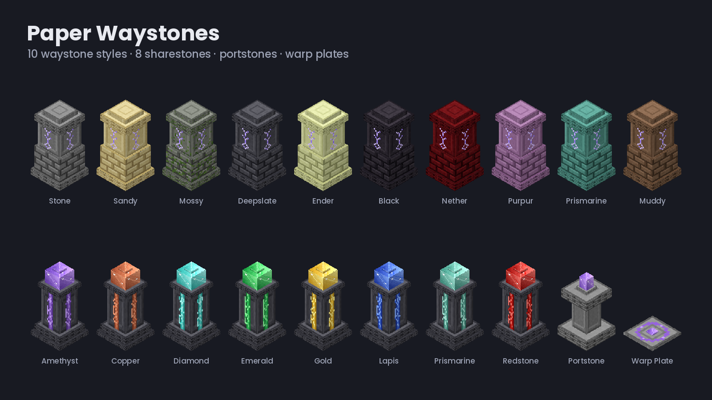
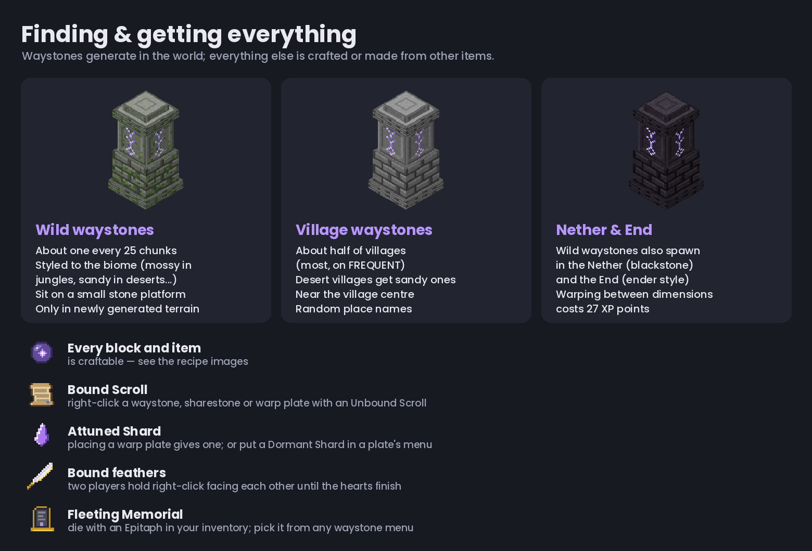
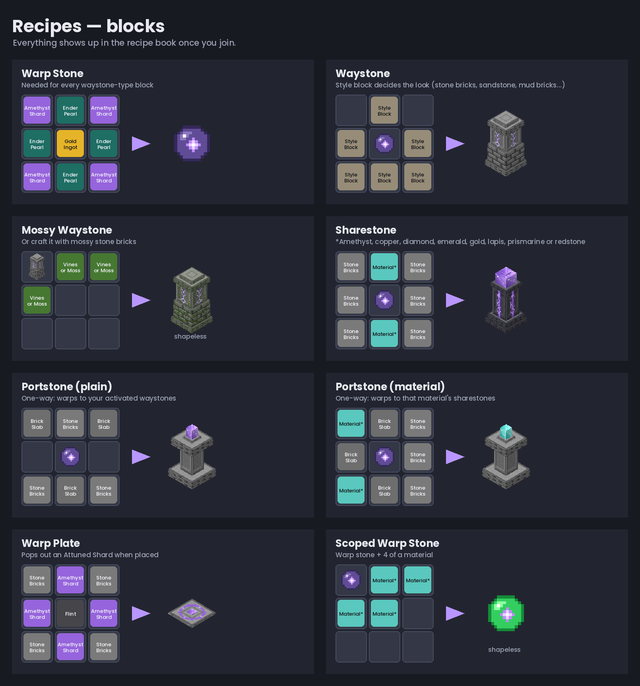
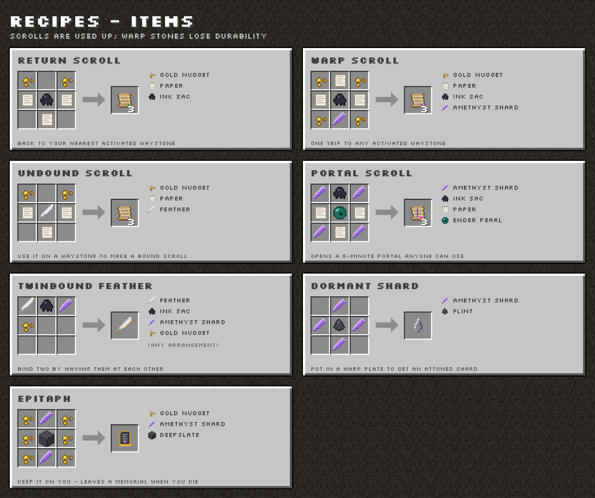

# Paper Waystones

A server-side take on BlayTheNinth's [Waystones mod](https://modrinth.com/mod/waystones) for **Paper 1.21.4 – 26.3** — no client mods. This is an independent fan project, not affiliated with the original. Players get a small
resource pack automatically, which gives the custom blocks and items their look. All code and
textures here are original (the mod itself is All Rights Reserved, so nothing is copied from it).

## Features

| Thing | What it does |
|---|---|
| **Waystone** (10 styles: stone, sandy, mossy, deepslate, ender, black, nether, purpur, prismarine, muddy) | Right-click to activate, right-click again to pick a destination. Shift-right-click to rename, set visibility (activation / team / global) and fill 5 modifier slots. Silk-touch pickaxe picks it up *with* its activations. |
| **Sharestone** (8 materials) | Links to every sharestone of the same material, no activation needed. |
| **Portstone** (plain + 8 materials) | One-way: plain → your activated waystones, coloured → that material's sharestones. |
| **Warp Plate** | Stand on it (players, mobs, dropped items) to warp to a linked plate. Placing one pops out an Attuned Shard; put shards in other plates to link them. Several shards = random target (nether quartz = round robin). |
| **Warp Stone** (+ 8 scoped variants) | Warp to any activated waystone (scoped: that material's sharestones). Uses durability; mendable. |
| **Warp / Return / Unbound / Bound / Portal Scrolls** | Single-use warps. Portal Scroll opens a 5-minute portal anyone can walk through, plus a "Return to Portal" entry. |
| **Twinbound Feather** | Hold right-click facing another feather holder until the hearts stop — then you can warp to each other from waystones. |
| **Dormant / Attuned Shards** | Warp plate linking. |
| **Epitaph** | Keep one on you; when you die it leaves a one-use "Fleeting Memorial" to warp back. |
| **Modifiers** | Blaze powder, poisonous potato, ink sac, wither rose, feather, magma cream, milk / honey block, diamond (potency), amethyst / slime ball (plate speed), quartz (round robin), redstone torch (plate off when powered). |
| **Costs & cooldowns** | XP per block (0.01, max 27, 27 cross-dimension), warp stone durability, per-source cooldowns. |
| **Pets & leashed mobs** | Leashed mobs come with you (pets optional). |
| **World gen** | Wild waystones about every 25 chunks (style follows the biome) and in villages. Random place names or your own preset list. |
| **Favourites** | Shift-click a destination to pin it to the top. |
| **/waystone** | The mod's "inventory button" (a server plugin can't add a real button to the vanilla inventory): nearest / menu / named waystone, 5-minute cooldown. |

Not included: the JourneyMap / Dynmap / BlueMap integrations, the spider-eye modifier (it only
matters for single-use shards, which this version doesn't have), and the mod's Shogi rule engine —
the common settings are in `config.yml` instead.

## Finding and crafting

- **Wild waystones** generate about every 25 chunks (overworld, Nether and End), on a small platform
  styled to the biome. **Village waystones** appear in about half of villages (most on `FREQUENT`).
- They only appear in **newly generated chunks**. For areas players have already explored, an admin can
  add them with `/waystones place <x> <y> <z> <type> <name>` (e.g. `/waystones place ~ ~ ~ waystone/stone Spawn`).
- **Everything is craftable** (recipes below, also in the in-game recipe book). Bound Scrolls come from
  using an Unbound Scroll on a waystone, Attuned Shards from placing a warp plate or putting a Dormant
  Shard in one, and Fleeting Memorials from dying with an Epitaph.
- Items don't appear in loot chests.

## Building

Push to GitHub and the included Actions workflow builds `PaperWaystones-<version>.jar` (download it from the
run's artifacts, or push a tag like `v1.0.0` to attach it to a release). Locally: install JDK 21 and run
`./gradlew build` — the jar lands in `build/libs/`.

The textures and models are generated by `tools/make_pack.py` (needs Pillow). Edit it and run
`python3 tools/make_pack.py` to regenerate `src/main/resources/waystones-pack.zip`, then rebuild.

## Server setup

1. Drop the jar in `plugins/` and start the server once.
2. That's it for the resource pack: players download it from this GitHub repo (pinned to your plugin
   version), so it works behind Docker, TrueNAS apps and tunnels. To serve your own edited pack instead,
   put it at `plugins/PaperWaystones/custom-pack.zip`; it's then served from the server on port 8164
   (set `resource-pack.public-host` to the address players use, and make sure the port is reachable).
3. `/waystones reload` after editing `config.yml`.

The pack is added on top of any others (the server's own pack and other plugins' packs keep working).
It only uses the `waystones` namespace, so it doesn't override anything vanilla. If you'd rather merge it
into your own server pack, copy `plugins/PaperWaystones/waystones-pack.zip` into it and set
`resource-pack.enabled: false`.

## Commands

`/waystones activate|forget|place|list|count|gui|twinbound|cooldown|give|reload` (permission
`waystones.admin`, ops by default) and `/waystone` for everyone. `/waystones give <player> <item>` with
tab-complete gives any item.

## Recipes

Same layouts as the mod where it documents them: waystones = 6 of the style's block + a warp stone;
sharestones = stone bricks + 2 of the material + warp stone; warp stone = amethyst, ender pearls, gold
ingot; scrolls = paper, gold nuggets, ink sac (+ amethyst / feather / ender pearl); warp plate = stone
bricks, amethyst, flint; dormant shard = 4 amethyst + flint; epitaph = gold nuggets, amethyst, deepslate;
twinbound feather = feather, ink sac, amethyst shard, gold nugget. They all show in the recipe book.

## Releasing

Push a tag like `v1.0.1`. The workflow builds the jar, attaches it to a GitHub release and, if the
`MODRINTH_TOKEN` repository secret is set, publishes the same jar to Modrinth.

## License

MIT — see [LICENSE](LICENSE).
